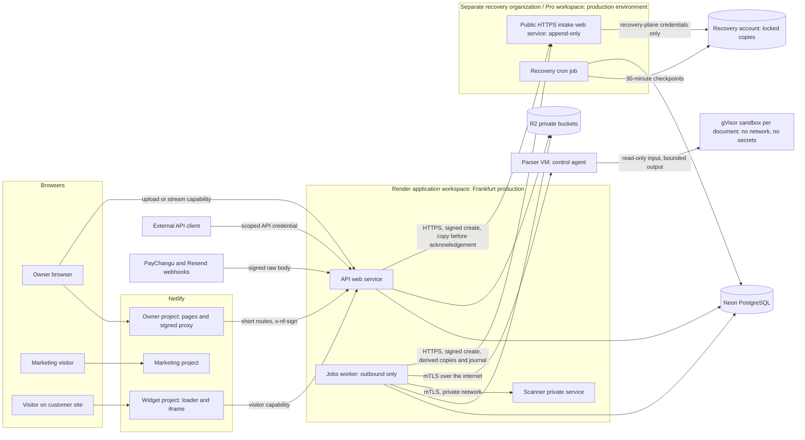

# Phase 3: domain and infrastructure design

Date: 4 November 2026 (Africa/Blantyre). Status: **reviewable Phase 3 design
bundle; documentation only.** It selects configuration and isolation designs
so that later phases can create them. It creates, purchases, configures,
deploys and migrates nothing. It claims no implemented capability, measured
capacity or achieved objective.

## Authority

| ID      | Authority                                                                                                                                                                                                                                                                                                                                                                                  |
| ------- | ------------------------------------------------------------------------------------------------------------------------------------------------------------------------------------------------------------------------------------------------------------------------------------------------------------------------------------------------------------------------------------------ |
| P3-U01  | Current chat instruction, 4 November 2026: "Implement Phase 3 only: domain and infrastructure design", with its ten steps, prohibitions and completion criterion. It authorizes documentation, read-only research, review and a documentation PR.                                                                                                                                          |
| P3-U02  | Current chat decision, paraphrased: use a dedicated Linux VM with gVisor for parser isolation. No provider, region, VM size, public price or purchase was approved. DigitalOcean Frankfurt 2 vCPU / 4 GiB at the dated USD 24 monthly public price (DO-01) is the selected engineering proposal.                                                                                           |
| P3-U03  | Current chat answer to the coverage question: **"Shane Viyazhi and Sherise Viyazhi"**. These are the named coverage people. Assigning Shane as primary and Sherise as backup, and the detailed responsibilities below, is the selected operational interpretation of their listing order, not a verbatim owner role assignment or proof of either person's availability or access.         |
| P3-U04  | Current chat decision, paraphrased: ten initial paying owners and qualification with 25 synthetic owners; a USD 1,000 monthly planning envelope plus a separate USD 250 emergency reserve; funding through a USD-capable account or card, with actual statement FX and fees recorded. This approves planning, not spending. The 100-owner stress cohort is an engineering test assumption. |
| P3-U05  | Current chat decision, paraphrased: an eight-day independent recovery retention window, including deleted bytes. The detailed checkpoint, lock and cleanup design implements that boundary; no retention behavior is yet demonstrated.                                                                                                                                                     |
| Release | The approved [v0.3 release contract](../../release/v0.3/release-specification.md), incorporating v0.2 and v0.1, is binding. Its catalogue, allowances, lifecycle rules, languages and engineering targets are not changed here.                                                                                                                                                            |
| P-01    | `Nthawi_io_Production_Implementation_Plan.pdf`, 30 October 2026, SHA-256 `8a4368e2a68ae4f62d1cc5916ef456ba7f13a3025fcc07dc1f7a1cd5be27d5e9`, re-verified 4 November 2026. Page 10 Phase 3 gate: **"Reviewed configuration and isolation decision, ready for creation."**                                                                                                                   |

Only the current chat decisions summarized above supply owner authority.
No answer time or repeat confirmation is asserted. Earlier drafts and any
approval claims attributed to unavailable conversations remain reference
material. Their technical proposals can be retained as selected designs,
without treating them as owner approval. Preservation evidence is recorded
in [execution and acceptance](execution-and-acceptance.md).

## Bundle

| Document                                                                                                                                                             | Contents                                                                                                                               |
| -------------------------------------------------------------------------------------------------------------------------------------------------------------------- | -------------------------------------------------------------------------------------------------------------------------------------- |
| This page                                                                                                                                                            | Environments, topology, trust boundaries, data flows, component access, failure paths and release responsibilities.                    |
| [Hosting](hosting.md)                                                                                                                                                | Hostname map, registrar and Cloudflare sequence, Netlify projects and routing, Render services.                                        |
| [Data and recovery](data-and-recovery.md)                                                                                                                            | Neon, private R2 storage, object lifecycle, deletion and retention, independent recovery.                                              |
| [Parser isolation](parser-isolation.md)                                                                                                                              | Hostile-document isolation decision, enforcement matrix, extraction contract, bounds and benchmark plan.                               |
| [Configuration](configuration.md)                                                                                                                                    | Secrets and configuration matrix, leakage controls, revocation and transactional email.                                                |
| [Capacity and operations](capacity-and-operations.md)                                                                                                                | Load cohorts, budgets, funding, availability probes, operational ownership and objective feasibility.                                  |
| [Execution and acceptance](execution-and-acceptance.md)                                                                                                              | Source timestamps, decision register, Phase 3 traceability, future operations runbook, verification and completion state.              |
| [Hosting evidence](../../sources/phase-3-hosting-research-2026-11-04.md), [data and isolation evidence](../../sources/phase-3-data-isolation-research-2026-11-04.md) | Dated observations and official documentation statements cited as `OBS-*`, `NET-*`, `RDR-*`, `CF-*`, `NEON-*`, `R2-*` and similar IDs. |

Status words are used consistently. **Observed**: read on 4 November 2026.
**Approved**: only the explicit owner decision in P3-U02 to P3-U05, within
its stated boundary, or the release contract.
**Selected design**: this phase's engineering choice, reviewable and traceable
in the [decision register](execution-and-acceptance.md#decision-register).
**Proposed name**: a configuration or resource name that does not exist yet.
**Unverified**: needs execution evidence in a named later phase.

## Design at a glance

- Hostnames follow the plan's flat map; `www.nthawi.io` is the canonical
  marketing host because Netlify cannot CDN-route an external-DNS apex
  (NET-09). Every record starts DNS-only, and certificates belong to the origin
  provider. See [hosting](hosting.md#hostname-map).
- Netlify hosts six projects: marketing, owner and widget, each in staging and
  production. Owner authentication stays same-origin on `app.nthawi.io` through
  short signed proxy routes; uploads and streams go directly to `api.nthawi.io`
  with scoped capabilities.
- Render's application workspace hosts the Frankfurt API web service, jobs
  background worker and ClamAV private service. A recovery-only Pro workspace
  in a separate Render organization/account hosts public HTTPS intake web
  services and recovery cron jobs,
  with separately scoped staging and production environments. Recovery-only
  provider identities and API tokens have no application-workspace membership;
  application identities have no recovery-workspace membership. The same
  humans may hold distinct identities. Pro allows one workspace per
  organization (RDR-11), so these are two organizations with two subscriptions.
  Protected environments keep private
  isolation enabled. Deploys promote digest-pinned images, and auto-deploy is off.
- Documents are parsed on a dedicated Linux VM per environment with gVisor
  (P3-U02). DigitalOcean Frankfurt is the selected engineering proposal;
  vendor and purchase approval remain for later creation. Each document runs
  in a fresh sandbox with no network, no secrets and host-enforced limits.
  See [parser isolation](parser-isolation.md).
- The existing Neon London project is the production candidate for Phase 4
  readiness, on the Launch plan with 7-day history. Staging gets a separate
  project. All runtime connections stay direct.
- Private R2 buckets per environment hold quarantine, originals and derived
  artifacts. A separate Cloudflare recovery account holds locked checkpoints
  and object copies for eight days (P3-U05).
- Operations: Shane primary and Sherise backup are selected role assignments
  from the named pair (P3-U03); a 10-owner launch cap sits inside the approved
  USD 1,000 monthly planning envelope plus USD 250 reserve (P3-U04).
  Minute-level availability probes are designed for two independent external
  locations.

## Environments

| Environment | Data and credentials                                                                                                                                                                                                                                                                              | Location and lifetime                                                                                                                                                                     | Reused or new                                                                                                                                                      |
| ----------- | ------------------------------------------------------------------------------------------------------------------------------------------------------------------------------------------------------------------------------------------------------------------------------------------------- | ----------------------------------------------------------------------------------------------------------------------------------------------------------------------------------------- | ------------------------------------------------------------------------------------------------------------------------------------------------------------------ |
| Local       | Synthetic data only. Existing Docker PostgreSQL container and volumes are preserved. Provider adapters are stubbed unless the developer supplies personal sandbox keys. The private `.env` is never copied, printed or bundled.                                                                   | Developer machine; loopback origins (`localhost:3000/4000/5173`).                                                                                                                         | Existing local stack (Phase 1 evidence). No change.                                                                                                                |
| CI          | Disposable tmpfs PostgreSQL per run, synthetic credentials, no provider or customer secrets; workflow token `contents: read`; fork pull requests receive nothing privileged.                                                                                                                      | GitHub-hosted Linux runners; destroyed after each run.                                                                                                                                    | Existing workflows `Verify repository` and `Verify Neon contracts`. Image publishing is a future Phase 5 workflow change.                                          |
| Staging     | Separate Neon project with synthetic data only; staging R2 buckets; staging parser VM; staging Render environment; provider test modes (PayChangu sandbox, Resend staging domain with recipient allowlist); separate OAuth client. No production data, live payment key or production credential. | Render Frankfurt; Neon in the production database region (Phase 4 confirms); DigitalOcean Frankfurt; R2 `weur`; Netlify functions `fra`. Long-lived; rebuilt from reviewed configuration. | All new.                                                                                                                                                           |
| Production  | Customer data; live merchant configuration (Phase 7); production-only secrets in platform stores; restricted runtime roles; separate operator, migration and recovery credentials.                                                                                                                | Render Frankfurt; Neon London (`aws-eu-west-2`, existing); DigitalOcean Frankfurt; R2 `weur`; Netlify functions `fra`; Resend `eu-west-1`.                                                | Neon project `delicate-feather-83629956` is reused if Phase 4 accepts it; everything else is new. The unrelated Render `drivesmart-backend` service is not reused. |

Region rationale. Render's only EU region is Frankfurt (RDR-06), and region is
permanent. Netlify functions run in `fra` (Pro) to sit next to the API
(NET-02). R2 uses the `weur` hint (R2-06). Reusing the London Neon project
keeps Phase 1 continuity, but every API query crosses the Frankfurt-London link.
The latency is unmeasured. Phase 5 must measure p95 database round trips from
Render Frankfurt. A result above 25 ms, or owner journeys missing their probe
deadlines, returns the database-region decision to the owner before production
creation; moving regions means a new Neon project and a guarded migration.
Resend `eu-west-1` keeps sending in Europe, but account data stays in the
United States (RES-02). No data-residency requirement is approved; this
placement is a latency choice, not a residency promise.

A staging deployment never receives production data, live payment keys,
production OAuth secrets, the production proxy-signing secret or production
storage tokens. Environment separation is enforced by separate Netlify
projects, separate Render environments with private-traffic blocking (RDR-10),
separate Neon projects, separate buckets with bucket-scoped tokens, and
separate parser VMs.

Recovery intake crosses organization/workspace boundaries over public HTTPS, using signed,
narrow create requests. It needs no cross-environment private-network access.
Render terminates TLS at its load balancer, so client authentication is an
application signature rather than mTLS. The recovery workspace alone stores
raw recovery R2 credentials; no application-workspace service, environment
group, build or deployment token can read them.

## Topology

## Trust boundaries

| Boundary                      | What crosses it                                            | Required control                                                                                                                                                                                                                                                                                                                                                       |
| ----------------------------- | ---------------------------------------------------------- | ---------------------------------------------------------------------------------------------------------------------------------------------------------------------------------------------------------------------------------------------------------------------------------------------------------------------------------------------------------------------- |
| B1 Owner browser to owner app | HTML, same-origin JSON, host-only session cookie           | HTTPS only; cookie omits `Domain` to remain host-only and sets `Secure`, `HttpOnly` and `SameSite=Lax` or stricter; Better Auth origin/CSRF checks; nonce CSP; private responses `no-store`.                                                                                                                                                                           |
| B2 Owner app to API           | Short auth and JSON calls through the Netlify signed proxy | API verifies `x-nf-sign` (expected site URL, Netlify ID, context, unexpired) **and** the session, origin and resource authorization. Owner cookies are refused on any request without a valid signature.                                                                                                                                                               |
| B3 Browser to API direct      | Uploads up to 10 MiB, streams                              | Short-lived capability bound to owner, workspace, resource, action, size, hash, expiry and lifecycle generation; exact CORS allowlist without credentials; server-side revocation and rate limits.                                                                                                                                                                     |
| B4 Visitor to API             | Widget conversation traffic from the iframe                | Visitor capability scoped to one installation and conversation; installation origin, paid status and abuse limits checked at issuance; no owner cookie or owner credential ever.                                                                                                                                                                                       |
| B5 External client to API     | Supported API calls                                        | Scoped, revocable API credential; owner authorization; 60 admitted requests per rolling 60 seconds per owner; idempotency; never billing administration.                                                                                                                                                                                                               |
| B6 Providers to API           | PayChangu and Resend webhooks                              | Signature over the raw body (PCH-01, RES-03), size limit, persisted event identity, asynchronous processing. A payment webhook is a hint until verification re-queries the provider.                                                                                                                                                                                   |
| B7 Runtime to data            | SQL and object operations                                  | Restricted roles with transaction-local tenancy; bucket-scoped tokens per consumer; no runtime holds migration, export or recovery-admin credentials.                                                                                                                                                                                                                  |
| B8 Worker to scanner/parser   | Already-received document bytes                            | Mutual TLS with environment-specific private-CA identities, request deadline, hash and size checks, bounded responses; scanner and parser hold no database, auth, payment, AI or storage credential.                                                                                                                                                                   |
| B9 Parser host to sandbox     | Read-only input and bounded output                         | gVisor with no network, read-only image, memory-backed bounded overlay, host cgroup limits, guest rlimits, watchdog and per-job teardown.                                                                                                                                                                                                                              |
| B10 Recovery plane            | Checkpoints, object copies, deletion journal               | Separate Cloudflare account and separate recovery-only Render organization/account and Pro workspace, with independent identities and tokens. Public HTTPS intake authenticates signed narrow create requests, not mTLS. API/jobs have no raw recovery R2 key or recovery-workspace membership. Locks protect retention; restore and cleanup use separate credentials. |
| B11 Operators and CI          | Deployments, migrations, DNS, provider administration      | MFA on every provider account; least-privilege, short-lived tokens; production changes only on the owner's command; merge permission never implies deploy or migration permission.                                                                                                                                                                                     |

## Data flows

1. **Owner request.** The browser loads `https://app.nthawi.io`. Proxy
   (Next.js 16's renamed middleware) sets a per-request CSP nonce (NXT-02).
   Same-origin calls to `/api/auth/*` and `/api/v1/*` are rewritten by Netlify
   to `https://api.nthawi.io` with `x-nf-sign` (NET-01). The API verifies the
   signature, then the session, origin and resource, before any transaction,
   reservation or storage access. Server rendering that needs owner data calls
   the same-origin proxy path with only the incoming cookie, never
   `api.nthawi.io` directly.
2. **Visitor conversation.** A customer page loads the versioned loader from
   `widget.nthawi.io`, which creates an iframe on the widget origin. The loader
   and iframe exchange `postMessage` only after checking exact origin and source
   window. The iframe obtains a visitor capability from the API, then sends
   messages with idempotency keys and receives ordered events by direct
   streaming. Stream and reconnect deadlines belong to Phase 12.
3. **External API.** A client calls `https://api.nthawi.io/api/v1/...` with a
   scoped credential. The API admits it against the owner's rate and term
   allowance before work, and replays idempotent results.
4. **Upload and ingestion.** The owner asks for an upload intent through the
   short proxy. The API reserves stock, flow and an owner slot transactionally
   and issues a one-use capability. The browser streams the file directly to
   the API. The API enforces the 10,485,760-byte limit on actual bytes,
   hashes the stream, writes a fresh quarantine object, and obtains a recovery
   copy receipt from the append-only recovery intake gateway before
   acknowledging receipt. The gateway owns the raw recovery-store credential;
   API/jobs sign narrow create requests with separate environment-specific
   Ed25519 keys. Each signature binds environment, operation, object identity,
   hash, byte length, lifecycle generation, timestamp and nonce. The intake
   enforces freshness, durable replay prevention and immutable creation;
   those signing keys cannot overwrite or delete recovery objects. The worker
   leases the job, sends
   the frozen bytes to the scanner, then to the parser VM, validates the
   bounded output, and records an extraction awaiting review. Approval binds
   the exact content hash; indexing settles embedding usage; publication swaps
   the published pointer atomically. Revision N stays published while N+1 is
   prepared.
5. **Payment notification (Phase 7).** PayChangu returns the browser to a
   pending page and posts a webhook. The API verifies the `Signature` HMAC over
   raw bytes, stores the event, and the worker re-queries the transaction.
   Exactly one grant is created only after the order, reference, status, exact
   MWK gross, currency and environment match. The merchant amount unit stays a
   Phase 7 gate.
6. **Email events.** Notices are queued in the database outbox and sent by the
   worker. Resend webhooks update delivery evidence only; they never change
   payment or access state.
7. **Recovery.** Every 30 minutes the recovery job exports a consistent
   database snapshot to the recovery account. Object copies already exist from
   step 4. Restores go to closed, isolated targets. Deletions and revocations
   are replayed from the independent journal, and reconciliation runs before
   traffic reopens. See [data and recovery](data-and-recovery.md#recovery-design).

## Component access matrix

"None" is a design requirement, not an observation. Rows list credentials per
consumer; no row inherits another's.

| Component            | Database                                                                | Object storage                                                      | Other secrets                                                                                                                                              | Must never hold                                                             |
| -------------------- | ----------------------------------------------------------------------- | ------------------------------------------------------------------- | ---------------------------------------------------------------------------------------------------------------------------------------------------------- | --------------------------------------------------------------------------- |
| Marketing project    | None                                                                    | None                                                                | None (public build values only)                                                                                                                            | Any server secret.                                                          |
| Owner project        | None                                                                    | None                                                                | Proxy-signing secret (Runtime scope only)                                                                                                                  | Database URLs, auth secret, provider keys.                                  |
| Widget project       | None                                                                    | None                                                                | None                                                                                                                                                       | Any secret or owner credential.                                             |
| API                  | `nthawi_auth`, `nthawi_business`                                        | Quarantine write; originals and derived read (gateway)              | Auth secret, OAuth, Resend (auth email), capability key, proxy secret, environment-specific recovery-intake create signing key; later PayChangu and AI     | Migration, export, jobs, raw recovery R2 or recovery-workspace credentials. |
| Jobs worker          | `nthawi_jobs` (grants reviewed in Phase 8)                              | Quarantine read and delete; originals and derived write and delete  | Scanner and parser mTLS client identities, environment-specific recovery-intake create signing key, Resend notice key; later AI and PayChangu verification | Migration, export, auth, raw recovery R2 or recovery-workspace credentials. |
| Scanner              | None                                                                    | None (bytes arrive in the request)                                  | Its mTLS server identity                                                                                                                                   | Every other credential.                                                     |
| Parser control agent | None                                                                    | None (bytes arrive in the request)                                  | Its mTLS server identity                                                                                                                                   | Every other credential, including provider tokens.                          |
| Parser sandbox       | None                                                                    | None                                                                | None                                                                                                                                                       | Anything beyond its read-only input.                                        |
| Recovery intake      | None                                                                    | Recovery store writer, held only inside the recovery-only workspace | Approved sender public keys and scopes; receipt signing key; verifies request binding, freshness and nonce replay protection over public HTTPS             | Application-workspace administration, database, auth or payment secrets.    |
| Recovery job         | Export login that can `SET ROLE` to bypass row security (Phase 4 proof) | Recovery store writer only, inside the recovery plane               | Manifest signing key                                                                                                                                       | Application runtime roles, auth or payment secrets.                         |
| Operators            | Migration login in a recorded window; read-only inspection              | Bucket administration; recovery-account administration              | Provider administration with MFA                                                                                                                           | Standing production secrets on laptops beyond the vault.                    |
| CI                   | Disposable test database only                                           | None                                                                | Workflow token (`contents: read`; `packages: write` only in a future protected publish job)                                                                | Production or staging secrets in pull-request workflows.                    |

## Dependencies and failure paths

| Dependency failure                | Behavior                                                                                                                                                                                         |
| --------------------------------- | ------------------------------------------------------------------------------------------------------------------------------------------------------------------------------------------------ |
| Neon unavailable                  | `/health/ready` returns 503 and Render stops routing (RDR-05); no admission that needs durable state; no grant, message or upload is acknowledged without a commit. Counts against availability. |
| R2 unavailable                    | Upload intents fail before acknowledgement; downloads return a safe error; reservations held until reconciled.                                                                                   |
| Recovery intake/store unavailable | Uploads are not acknowledged (copy-before-acknowledge); checkpoint age alarms; ingestion pauses with a clear state rather than accepting unprotected objects.                                    |
| Scanner unavailable or stale      | Jobs stay quarantined and queued; fail closed; nothing is parsed or published.                                                                                                                   |
| Parser VM unavailable             | Jobs wait within their deadline, then fail with a bounded, retryable status; no partial publication.                                                                                             |
| AI provider failure               | Generation outcome held pending; no automatic second paid call while the first is uncertain (v0.2 accounting rules).                                                                             |
| Resend failure                    | Outbox retains notices with durable retries; missing email never extends access or proves payment.                                                                                               |
| PayChangu failure                 | A browser return or webhook grants nothing; reconciliation retries verification; no fallback currency.                                                                                           |
| Netlify failure                   | Owner and widget journeys fail and count against availability; API, webhooks and jobs continue.                                                                                                  |
| Render region failure             | All application compute is down; recovery copies remain independent; recovery into another region is a declared incident with RTO counting (no multi-region claim).                              |

## Release, migration and rollback responsibilities

| Action            | Authority                                                                                                                  | Artifact and evidence                                                                                             | Rollback                                                                                                                                  |
| ----------------- | -------------------------------------------------------------------------------------------------------------------------- | ----------------------------------------------------------------------------------------------------------------- | ----------------------------------------------------------------------------------------------------------------------------------------- |
| Merge to `master` | Ruleset 24955831: one independent approval, resolved threads, strict `Step 3 gate`; the owner's explicit merge instruction | Reviewed PR head and hosted checks                                                                                | Revert through a new reviewed PR.                                                                                                         |
| Staging deploy    | Owner's command for the phase; primary operator executes                                                                   | Digest-pinned images (Render), a Netlify deploy built from the same commit                                        | Publish the previous Netlify deploy (NET-08); redeploy the previous image digest.                                                         |
| Production deploy | Separate owner command (Phase 16 for the public release)                                                                   | The same image digests that passed staging; Netlify production deploys from the same commit                       | Same as staging, then verify journeys.                                                                                                    |
| Migration         | Separate owner command per migration; primary operator executes, backup verifies                                           | Rehearsed on a Neon branch; guarded direct target; before and after schema, grant and row-level-security evidence | Forward fix by preference. A database restore is an incident decision with deletion replay; an image rollback never reverses a migration. |
| Recovery restore  | Incident commander, recorded decision                                                                                      | Signed checkpoint manifest and deletion watermark                                                                 | Keep traffic closed until journeys pass; choose an earlier verified point within the window or declare the target missed.                 |

A green CI result authorizes neither a deployment nor a migration. Auto-deploy
stays off on every service and project. Phase 3 performs none of these actions.

## Phase boundaries

- **Phase 3 (this bundle):** documentation, read-only research and review.
- **Phase 4:** Neon readiness: archived-branch lifecycle, isolated acceptance,
  plan and history, export-role proof, production promotion procedure. Nothing
  here touches Neon.
- **Phase 5:** reproducible staging: create the approved services, attach
  staging DNS, telemetry and probes, then verify over HTTPS.
- **Phases 6 to 16:** product implementation, processing services, parser
  implementation (Phase 9), recovery drills (Phase 15) and production release
  (Phase 16), each on its own command.
